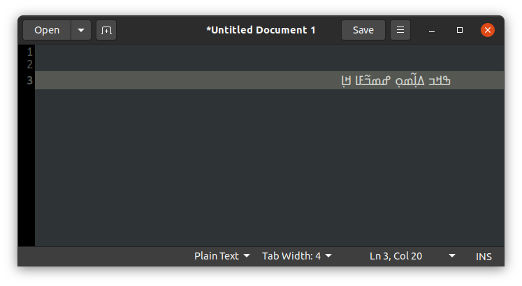
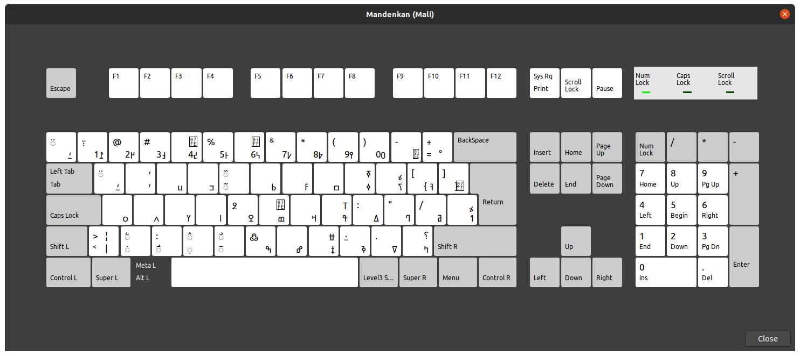
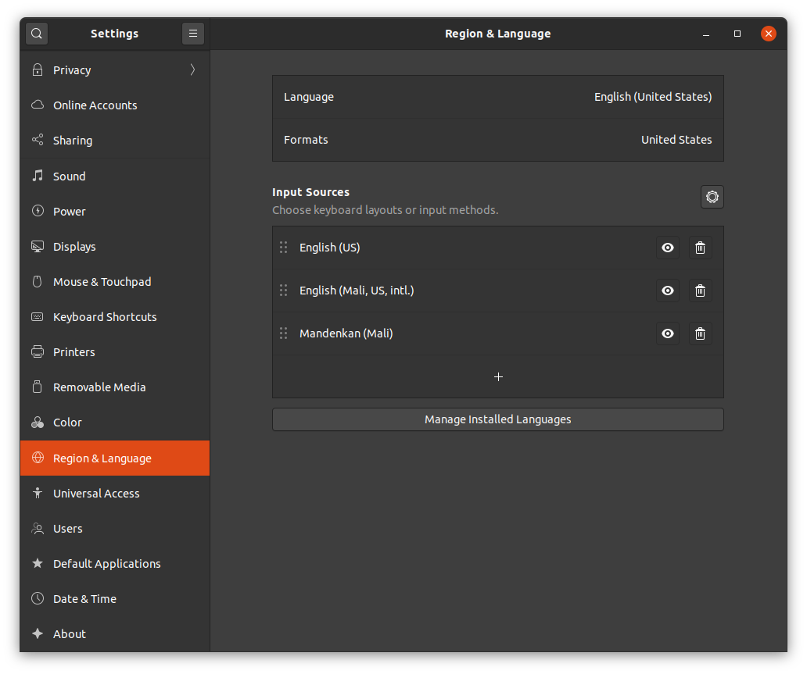
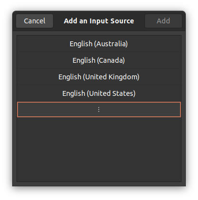
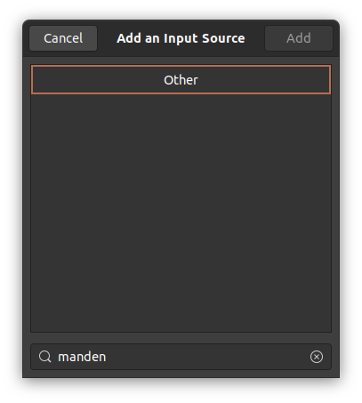
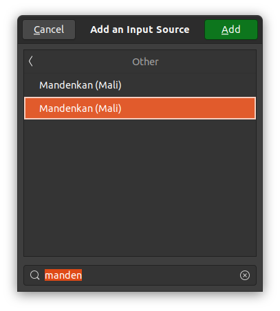

# N'Ko (`nqo`) Native Keyboard Support for Ubuntu & Linux

A native, robust, and cleanly integrated keyboard layout for the **N'Ko language (`nqo`)** on modern Ubuntu Linux Desktop (**Ubuntu 26.04 LTS, 24.04 LTS, 22.04 LTS**), supporting **GNOME Shell on Wayland** and **X11**.



---

## Key Highlights & Modern Architecture

- **Native Wayland & GNOME Shell Integration**: Seamlessly recognized by `libxkbregistry` and appears directly in **GNOME Settings &rarr; Keyboard &rarr; Input Sources**.
- **OS & Package Upgrade Survivability**: Configures an automated APT post-invoke hook (`/etc/apt/apt.conf.d/99-xkb-nqo-reapply`). The layout is **never wiped out** when Ubuntu updates `xkb-data` (`xkeyboard-config`) during routine `apt upgrade` or system distribution upgrades.
- **Non-Destructive & Idempotent**: Safely parses and injects modular XML definitions into `evdev.xml` and `base.xml` with pre-commit syntax validation and automatic timestamped backups. Does **not** clobber system configuration files.
- **Zero-Restart Desktop Activation**: Supports immediate layout activation for the active user via `--activate` without requiring logout or reboot.
- **Clean Uninstallation**: Ships with `uninstall-nko.sh` to cleanly reverse all changes and restore system state.
- **Full Script & Tone Coverage**: Complete Unicode N'Ko block (U+07C0–U+07FF), including digits, consonants, vowel diacritics, combining tone marks, and punctuation, plus Level 3 (AltGr) layer for Latin digits and symbols.
- **Dedicated VM Testing Pipeline**: Includes automated unit tests and a fresh VM provisioning harness (`Vagrantfile` + `scripts/test-vm.sh`).

---

## Keyboard Layout Preview



---

## Prerequisites

- **Supported Distributions**: Ubuntu 26.04 LTS, Ubuntu 24.04 LTS, Ubuntu 22.04 LTS, Debian 12+.
- **Desktop Environments**: GNOME Shell (Wayland or X11), XFCE, KDE Plasma, MATE.
- User account with `sudo` privileges.
- Standard tools installed (`python3`, `git`).

---

## Quick Start Installation

Clone the repository and run the installer:

```bash
git clone https://github.com/munjata/nqo-keyboard.git
cd nqo-keyboard
sudo ./install-nko.sh --activate
```

> [!TIP]
> The `--activate` (or `-a`) flag automatically registers **N'Ko (Mandenkan)** into your active GNOME desktop input sources. You can immediately toggle it using <kbd>Super</kbd> + <kbd>Space</kbd>!

### Command Line Options

```text
Usage: sudo ./install-nko.sh [OPTIONS]

Options:
  -a, --activate    Automatically activate N'Ko layout in GNOME input sources
  -d, --dry-run     Validate symbols and test patching without modifying system files
  -h, --help        Show this help message and exit
```

---

## Manual Desktop Configuration (GNOME GUI)

If you prefer to configure the layout graphically through GNOME Settings:

1. Open **Settings &rarr; Keyboard** (or **Region & Language** on older Ubuntu releases).
2. Under **Input Sources**, click **`+`** (Add Input Source):

   

3. Scroll down and click the three vertical dots (**More / Other**):

   

4. Search for `manden` or `nqo` and select **Other**:

   

5. Select **N'Ko (Mandenkan)** or **Mandenkan (Mali)**:

   

6. Switch between your standard layout and N'Ko using <kbd>Super</kbd> + <kbd>Space</kbd>.

---

## Testing & Verification

### Local Unit Tests

Run the built-in automated test suite (validates XKB compilation, XML syntax, patcher idempotency, and `libxkbregistry` discovery):

```bash
python3 tests/verify.py -v
```

### Dedicated Fresh VM Testing

To verify the installation, APT upgrade survivability, and clean uninstallation on a completely fresh, disposable virtual machine:

```bash
# Automated libvirt / QEMU test (Ubuntu 26.04 cloud image)
./scripts/test-vm.sh --libvirt

# Or via Vagrant
vagrant up --provision

# Or via isolated container
./scripts/test-vm.sh --container
```

---

## Uninstallation

To cleanly remove the layout and restore all system files to their original state:

```bash
sudo ./uninstall-nko.sh
```

---

## Repository Structure

```text
.
├── nqo                     # XKB symbols definition (U07xx Unicode keysyms)
├── evdev-snippet.xml       # Modular layout registration snippet
├── patch-xkb.py            # Idempotent XML & rules patcher with pre-validation
├── install-nko.sh          # Non-destructive installer with APT hook setup
├── uninstall-nko.sh        # Clean system uninstaller
├── NotoSansNKo-Regular.ttf # N'Ko font fallback
├── Vagrantfile             # Libvirt VM configuration for clean testing
├── scripts/
│   └── test-vm.sh          # Automated VM test runner
├── tests/
│   └── verify.py           # Automated unit and integration test suite
└── images/                 # Layout diagrams and installation screenshots
```

---

## License

Open source under the [GNU General Public License v3.0](LICENSE).
